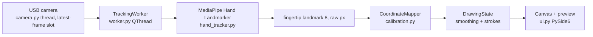

# FingerTrace PoC

**Air-drawing, not touchscreen input.** A USB camera sees your index fingertip in front of the screen; the app
draws its path on a canvas. CPU-only, fully local, no accounts or network (except the explicit model download).



## Verified environment
macOS 15 (Darwin 24.6) on Apple Silicon, Python 3.14.7 (Homebrew), `mediapipe==1.1.1`,
`opencv-python==5.0.0.93`, `PySide6==6.12.0`. Unit tests, model load and offscreen UI launch were verified;
**physical camera tracking was not validated** (the build sandbox had no camera permission).

## Setup
```bash
python3 -m venv .venv
source .venv/bin/activate
python -m pip install --upgrade pip
pip install -r requirements.txt
python scripts/download_model.py     # explicit, one-time, ~8 MB
python app.py
pytest                               # unit tests
```

## Camera and macOS permission
Grant camera access to the app that launches Python (Terminal / iTerm / VS Code):
System Settings > Privacy & Security > Camera. Restart that app afterwards. Pick the camera in the dropdown
(`Refresh` re-probes indices 0-3; the built-in camera is usually 0, the USB one 1) and press **Start Camera**.
Requested 1280x720 @ 30 FPS; the actual values are read back and shown in Diagnostics.

## Using it
- **Draw mode** (remembered): *Pinch to draw* (default) draws only while thumb and index are pinched, with the
  pointer at their midpoint (green dot = pen down, red = pen up); *Always draw* follows the index tip and always
  draws. This is the practical substitute for touch detection, which one ordinary camera cannot do.
- **Draw Enabled** off = *Paused* (cursor still follows, nothing is drawn). **Clear Canvas** removes all strokes.
- Losing the hand ends the stroke; when it returns a new stroke starts, so no long connecting line.
- **Mirror Camera** (default off, remembered between runs): off = raw camera view, correct when the camera looks
  the same way you do (e.g. aimed at the screen). On = selfie-style mirror, correct when the camera faces you.
  If the stroke moves opposite to your hand, flip this checkbox. Toggling mirror resets calibration.
- **Calibrate**: point your fingertip at each highlighted target (TL, TR, BR, BL) and press **Space** /
  *Confirm Point*; Esc cancels. Points are checked (duplicates, wrong order, degenerate area) and a homography
  (`cv2.getPerspectiveTransform`) maps the camera quadrilateral to the canvas. Without calibration the app shows
  **UNCALIBRATED — linear fallback** (full camera frame stretched to the canvas). *Reset Calibration* returns to it.
- **Flip Vertical** (remembered): for a camera mounted upside down. Like Mirror, it resets calibration.
- Smoothing: One Euro filter (`ONE_EURO_MIN_CUTOFF` lower = steadier at rest, `ONE_EURO_BETA` higher = less lag
  while moving, both in `src/config.py`).

## Chess application
Choose **Chess (pinch to move pieces)** in the *Application* dropdown (default: Air Drawing). Both sides are
played by you (hot-seat); rules and legality come from [`python-chess`](https://pypi.org/project/chess/).
- Pointer = midpoint between thumb tip and index tip (green dot while pinching, red otherwise).
- **Pinch** (bring thumb and index together) over a piece of the side to move to pick it up: the square turns blue
  and legal destinations get green dots. **Open the fingers** over a square to drop it. Illegal drops, drops
  outside the board, or dropping on the origin square return the piece.
- Losing the hand cancels the move; you must open the fingers once before grabbing again.
- Pawn promotion is automatic (queen). *New Game* resets. Calibrate the same way as for drawing (recommended:
  the board is in the middle of the canvas, so the uncalibrated fallback already works roughly).
- Pinch thresholds (`PINCH_ON_RATIO` / `PINCH_OFF_RATIO`) and board size are in `src/config.py`.

## Keyboard typing application (experimental)
Choose **Keyboard typing (camera reads keys)**. The camera looks at your keyboard from above; the app tries to infer
which key a fingertip pressed and types it into the "Read by camera" box. Two hands, five fingertips each.
1. Optional: if the camera sees the keyboard upside down (a 180 degree rotation) turn **Mirror + Flip Vertical** both
   on so letters read normally. Calibration works either way because the steps name *keys*, not directions.
2. **Calibrate Keyboard**, then *click* four corners of the whole key area on the camera preview, in this order:
   outer top-left of the **esc** key, outer top-right of the **power / Touch ID** key, outer bottom-right of the
   **arrow-key cluster**, outer bottom-left of the **fn** key. The matching key is highlighted on the canvas
   while you calibrate. The layout has six full-height rows (function row included); the cyan grid drawn on the
   preview shows where the app thinks each key is. If rows or columns are off, recalibrate (click the true outer
   corners of the key block, not the bezel). Key widths are a standard approximation, so columns can drift by up
   to about half a key in the middle of a row.
3. Type on the real keyboard as normal. The window must be focused; your real keystrokes are only used locally as
   ground truth and are compared with the camera's guesses (accuracy / wrong / missed / false in Diagnostics).
   The real keystrokes never reach the UI controls while this mode is active.

**How a press is inferred** (`src/press_detector.py`): from 2D fingertip motion only. A fingertip must *travel* over
the keyboard (> `TYPING_V_MOVE`) and then *stop* (< `TYPING_V_STOP`) for `TYPING_DWELL_S`; that fires one press on
the key under it, and it must move again before it can fire again. Resting fingers never type. Thumbs only type
space. All thresholds are in `src/config.py` (key units per second; 1 unit ~ 19 mm).

Known limits of this approach (one RGB camera has no reliable depth): repeating the *same* key without in-plane finger
movement is usually missed; fingers pausing over keys while repositioning can type by mistake; the fingertip is above
the key surface so an oblique camera sees it displaced from the key it presses; Shift/modifiers and uppercase are
not interpreted; accuracy has not been measured on real hands yet. Use the Diagnostics accuracy line to tune the
thresholds, and treat anything below ~90% as "not yet usable for typing".

## Troubleshooting
| Symptom | Fix |
|---|---|
| "No camera found" / "not authorized to capture video" | Grant camera permission (above), restart the terminal/IDE, press Refresh |
| Wrong camera | Choose another index in the dropdown (macOS Continuity Camera can shift indices) |
| "Hand Landmarker model not found" | `python scripts/download_model.py` |
| Cursor mirrored the wrong way | Toggle *Mirror Camera*, then recalibrate |
| Camera disconnected mid-run | Status shows *Camera unavailable*; reconnect, Refresh, Start |

## Layout
`src/camera.py` capture thread · `hand_tracker.py` MediaPipe · `worker.py` tracking thread/preview ·
`filters.py` One Euro smoothing · `calibration.py` mapping · `gesture.py` pinch · `keyboard_layout.py` / `press_detector.py` / `typing_session.py` / `typing_eval.py` / `typing_mode.py` / `typing_view.py` keyboard app · `chess_game.py` chess interaction · `canvas.py` rendering · `drawing.py` strokes · `metrics.py` FPS/timing · `ui.py` window · `config.py` constants.

## Known limitations
Air-drawing has no contact detection; depth/perspective makes the canvas area depend on hand distance.
One hand only. Inference time shown is the model call only, **not** end-to-end latency (see PERFORMANCE_TEST.md).
Camera index probing briefly opens each camera. No touch/contact detection: one RGB camera has no reliable depth (use pinch, a side-mounted camera or a depth camera).
Next experiment: measure end-to-end latency and tune the pinch thresholds and One Euro parameters on real use.
