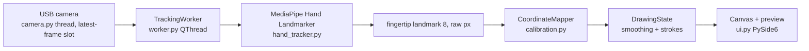

# FingerTrace PoC

**Air-drawing, not touchscreen input.** A USB camera sees your index fingertip in front of the screen; the app
draws its path on a canvas. CPU-only, fully local, no accounts or network (except the explicit model download).



## Verified environment
macOS 15 (Darwin 24.6) on Apple Silicon, Python 3.14.7 (Homebrew), `mediapipe==1.1.1`,
`opencv-python==5.0.0.93`, `PySide6==6.12.0`. Unit tests, model load and offscreen UI launch were verified;
**physical camera tracking was not validated** (the build sandbox had no camera permission).

## Setup
```bash
python3 -m venv .venv
source .venv/bin/activate
python -m pip install --upgrade pip
pip install -r requirements.txt
python scripts/download_model.py     # explicit, one-time, ~8 MB
python app.py
pytest                               # unit tests
```

## Camera and macOS permission
Grant camera access to the app that launches Python (Terminal / iTerm / VS Code):
System Settings > Privacy & Security > Camera. Restart that app afterwards. Pick the camera in the dropdown
(`Refresh` re-probes indices 0-3; the built-in camera is usually 0, the USB one 1) and press **Start Camera**.
Requested 1280x720 @ 30 FPS; the actual values are read back and shown in Diagnostics.

## Using it
- **Draw mode** (remembered): *Pinch to draw* (default) draws only while thumb and index are pinched, with the
  pointer at their midpoint (green dot = pen down, red = pen up); *Always draw* follows the index tip and always
  draws; *Point to draw* follows the index tip and draws while the index finger is straight, lifting the pen when you curl
  it (thresholds `POINT_ON_RATIO` / `POINT_OFF_RATIO` in `src/config.py`). This is the practical substitute for touch detection, which one ordinary camera cannot do.
- **Draw Enabled** off = *Paused* (cursor still follows, nothing is drawn). **Clear Canvas** removes all strokes.
- Losing the hand ends the stroke; when it returns a new stroke starts, so no long connecting line.
- **Mirror Camera** (default off, remembered between runs): off = raw camera view, correct when the camera looks
  the same way you do (e.g. aimed at the screen). On = selfie-style mirror, correct when the camera faces you.
  If the stroke moves opposite to your hand, flip this checkbox. Toggling mirror resets calibration.
- **Calibrate**: point your fingertip at each highlighted target (TL, TR, BR, BL) and press **Space** /
  *Confirm Point*; Esc cancels. Points are checked (duplicates, wrong order, degenerate area) and a homography
  (`cv2.getPerspectiveTransform`) maps the camera quadrilateral to the canvas. Without calibration the app shows
  **UNCALIBRATED — linear fallback** (full camera frame stretched to the canvas). *Reset Calibration* returns to it.
- **Flip Vertical** (remembered): for a camera mounted upside down. Like Mirror, it resets calibration.
- Smoothing: One Euro filter (`ONE_EURO_MIN_CUTOFF` lower = steadier at rest, `ONE_EURO_BETA` higher = less lag
  while moving, both in `src/config.py`).

## Chess on a projector (touch the pieces)
Choose **Chess on projector (touch the pieces)**. The screen is a projector, the camera sees the projected board, your
hand **and its shadow**. You touch a piece with the index finger, then touch the square it should go to (or touch a
piece and slide to the square before lifting). Both sides are played by you; rules come from
[`python-chess`](https://pypi.org/project/chess/).

**How a touch is detected** (one RGB camera has no depth, so it uses the shadow): the projector lights the hand from
one side, so a hovering fingertip casts a shadow displaced from it; as the finger lands the shadow slides under it.
The app memorises the empty projected board, marks pixels clearly darker than it as shadow (dark squares and a global
exposure change are not shadow), and scores the *visible shadow area around the index fingertip*. A touch is a low
score **with shadow right next to the fingertip** (a hand held high has no shadow near the fingertip and never counts).
Two reference scores that you record in calibration set the thresholds (`src/touch_detector.py`).

Setup, once per session:
1. *Open on projector screen* (pick the projector in the list; Esc closes it), or just move the main window
   there. Make the preview upright with Mirror / Flip Vertical.
2. *Start Camera*, then **Calibrate Projector (auto)** and keep your hands out of view:
   the canvas goes black, four white discs appear **on the four corner squares of the board** (the camera only has to
   see the board, not the whole canvas), and the two camera frames are differenced to find them
   (fallback: if the discs are not found you click them on the preview). The empty board is then memorised
   (hand away, about a second), then: **touch the ring** with your index fingertip and hold still 1.5 s, then
   **lift the fingertip about 3 cm above the ring** and hold. If the shadow barely changes between the two, the app
   says so instead of guessing.
3. Play. Selection survives the hand leaving. Touching the selected piece again deselects it. After each move the
   projected board changed, so touches pause until your hand has been away for ~0.4 s and the board is re-memorised.

Why it can fail: the shadow must be visible to the camera (projector and camera must not be on the same line, and the
hand must be lit from the side, not from directly behind the camera); the board is drawn small with a lit margin
because a finger near the canvas edge casts its shadow where the projector casts no light; highlights are drawn
brighter than the squares (outline and dots) so they can never pass for shadow. A strong ambient light or a
very dark room both reduce the shadow contrast. Pawn promotion is automatic (queen). *New Game* resets.
Thresholds and sizes are in `src/config.py` (`TOUCH_*`, `BACKGROUND_*`, `PROJECTOR_*`, `CHESS_SQUARE`).
The pinch-to-move chess of the earlier version was replaced by this one; pinch drawing is still in Air Drawing.

**Weak projector / hand hides its shadow.** The shadow is measured as the share of the *projected* light that has
disappeared (the black calibration frame is the room light alone), so a projector that adds only a little to a bright
wall still works. If the camera sees the shadow only behind the hand, **point-and-hold** works without any shadow:
keep the fingertip on a square for about a second (a green arc fills) to select it, then hold on the destination.
If the shadow references are rejected twice, the app goes on in point-and-hold only. Best fix for the shadow itself:
put the camera to the side (30-45 degrees off the projector axis) so the shadow lands beside the finger.

## Gomoku (cờ caro) on a projector

Choose *Gomoku on projector*. A 10 x 10 board is projected; calibrate and set the touch references exactly as for
chess (same discs, shadow touch, point-and-hold fallback). Touch an empty cell to place your stone: X (black) moves
first, then O (white). Five or more in a row, horizontally, vertically or diagonally, wins and is struck through in red;
*New Game* starts over. Code: `gomoku_game.py` (rules), `gomoku_view.py` (painting), `projector_gomoku.py` (a
`ProjectorChess` with a 10 x 10 marker layout).

## Air Drawing on a projector (move your hand over the canvas)

Choose *Air Drawing on projector* in the Application list. The canvas is shown on the projector as a black page
with bright strokes (dark ink would just be the unlit wall) and the hand is tracked where it really is on the
projection. Setup: *Open on projector screen*, *Start Camera*, then **Calibrate Projector (auto)** with your hands
out of view: four white discs appear near the canvas corners (8-92 % of the canvas, so the camera needs most of
the canvas, not the whole picture) and are found by differencing a black and a lit frame (fallback: click them on
the preview). Then draw as in Air Drawing: pinch thumb and index finger over the projection (*Pinch to draw*) or
choose *Always draw* or *Point to draw* (index out = draw, curled = lift); the dot at the pen position shows where the stroke will go. Strokes are kept in canvas
coordinates, *Clear Canvas* wipes them. A frame in the current pen colour marks the page, and a **colour palette**
runs down its left edge: rest the pen on a swatch for half a second (an arc fills) to pick that colour; while the pen is over the
palette it does not draw. Each stroke keeps the colour it was started with. Code: `projector_surface.py` (shared geometry calibration),
`projector_draw.py` (palette), `draw_view.py` (frame and palette painting).

## Piano on a projector (tap the keys to play)

Choose *Piano on projector* in the Application list. Two octaves (C4 to B5, 14 white and 10 black keys) are projected
as a lit keyboard; struck keys light up and sound. Setup is the same as Air Drawing on a projector: *Open on projector
screen*, *Start Camera*, **Calibrate Projector (auto)** with your hands out of view (four discs near the canvas corners,
fallback: click them on the preview), then play. Sound is synthesised at first use (24 piano-like tones, additive
harmonics with decay, played through Qt's `QSoundEffect`), so the Mac's volume applies.

How a key is struck: one RGB camera has no depth, so (as in the typing app) a press is a fingertip that **travels a
little onto a key and then pauses for about a tenth of a second**; fingers resting on the keys never sound, and every
fingertip of up to two hands counts, so chords work. The orange dots show where the app thinks the fingertips are; the pale
key is the one under a finger, the bright key was just struck. Black keys win over the white keys behind them. Tune with
`PIANO_SENSITIVITY` (higher = smaller movements strike) and the `TYPING_*` press constants in `src/config.py`.
Code: `piano_layout.py` (geometry), `piano_session.py` (fingertips to notes), `piano_sound.py`, `piano_view.py`,
`piano_mode.py`.

## Keyboard typing application (experimental)
Choose **Keyboard typing (camera reads keys)**. The camera looks at your keyboard from above; the app tries to infer
which key a fingertip pressed and types it into the "Read by camera" box. Two hands, five fingertips each (hands are told apart by wrist position, not MediaPipe's unreliable Left/Right label;
the detection thresholds are loosened to `TYPING_MIN_CONFIDENCE` in this mode so the second hand is picked up).
1. Optional: if the camera sees the keyboard upside down (a 180 degree rotation) turn **Mirror + Flip Vertical** both
   on so letters read normally. Calibration works either way because the steps name *keys*, not directions.
2. **Calibration is automatic** (checkbox *Auto-detect keyboard*, on by default): once the camera runs in this mode,
   `src/keyboard_detect.py` looks for the keyboard every 2 s until it finds it, on a background thread. It matches
   the outline of every key in the layout against the image edges (chamfer matching, any of 4 rotations with or
   without reflection), accepts only a convincing match and shows the cyan key grid on the preview so you can check
   it. Press *Auto-calibrate Keyboard now* to redo it after moving the camera or the laptop. It needs the whole
   keyboard in view, reasonably sharp and not too dark; it works with the picture upright, rotated 180 degrees,
   mirrored or slightly rotated. Changing Mirror / Flip Vertical resets the calibration and detects again.
   **Manual fallback:** *Calibrate Keyboard*, then *click* four corners of the whole key area on the camera preview,
   in this order:
   outer top-left of the **esc** key, outer top-right of the **power / Touch ID** key, outer bottom-right of the
   **arrow-key cluster**, outer bottom-left of the **fn** key. The matching key is highlighted on the canvas
   while you calibrate. The layout (`src/keyboard_layout.py`) has six full-height rows, 14.5 key pitches wide, measured
   from a MacBook Air (US-style, arrow cluster with half-height up/down); the cyan grid drawn on the preview shows
   where the app thinks each key is. If it is off, recalibrate by clicking the true outer corners of the key block,
   not the bezel. Other keyboards (ISO Enter, different bottom row) need their own layout, and automatic detection
   assumes this layout.
3. Type on the real keyboard as normal. The window must be focused; your real keystrokes are only used locally as
   ground truth and are compared with the camera's guesses (accuracy / wrong / missed / false in Diagnostics).
   The real keystrokes never reach the UI controls while this mode is active.

**How a press is inferred** (`src/press_detector.py`): from 2D fingertip motion only, purely spatial. A fingertip is
*armed* when it leaves its resting spot by more than `TYPING_ARM_DIST` (travelling to a key, or a small tap), then it
*fires* when it stays within `TYPING_STILL_RADIUS` for `TYPING_DWELL_S`: one press on the key under it. It cannot
fire again until it is armed again, so fingers resting on the keys never type, and an out-and-back tap of the same
key counts again. Thumbs only type space. Distances are in key units (1 unit ~ 19 mm).

**Sensitivity slider** (typing mode, remembered): 1..10 scales both distances (5 = the config values, 7 default,
10 = about 0.3x). Higher catches smaller finger movements but also types by mistake when the hand-landmark jitter is
large. Simulated resting hands, false presses per minute (jitter sigma in key units; 0.05 ~ 3 px on a typical view):

| jitter | s=5 | s=7 | s=8 | s=9 | s=10 |
|---|---|---|---|---|---|
| 0.03 | 0 | 0 | 0 | 0 | 0.2 |
| 0.05 | 0 | 0 | 0.2 | 1.0 | 8.2 |
| 0.08 | 0 | 1.0 | 8.8 | 79 | 141 |

These numbers come from synthetic noise, not real hands: raise the slider until the Diagnostics "missed" count drops,
and back off if "false" starts to rise.

Known limits of this approach (one RGB camera has no reliable depth): repeating the *same* key without any in-plane finger
movement (less than `TYPING_ARM_DIST`) is missed; fingers pausing over keys while repositioning can type by mistake; the fingertip is above
the key surface so an oblique camera sees it displaced from the key it presses; Shift/modifiers and uppercase are
not interpreted; accuracy has not been measured on real hands yet. Use the Diagnostics accuracy line to tune the
thresholds, and treat anything below ~90% as "not yet usable for typing".

## Troubleshooting
| Symptom | Fix |
|---|---|
| "No camera found" / "not authorized to capture video" | Grant camera permission (above), restart the terminal/IDE, press Refresh |
| Wrong camera | Choose another index in the dropdown (macOS Continuity Camera can shift indices) |
| "Hand Landmarker model not found" | `python scripts/download_model.py` |
| Cursor mirrored the wrong way | Toggle *Mirror Camera*, then recalibrate |
| Camera disconnected mid-run | Status shows *Camera unavailable*; reconnect, Refresh, Start |

## Layout
`src/camera.py` capture thread · `hand_tracker.py` MediaPipe · `worker.py` tracking thread/preview ·
`filters.py` One Euro smoothing · `calibration.py` mapping · `gesture.py` pinch · `keyboard_layout.py` / `keyboard_detect.py` / `press_detector.py` / `typing_session.py` / `typing_eval.py` / `typing_mode.py` / `typing_view.py` keyboard app · `chess_game.py` chess by touch · `touch_detector.py` shadow touch · `projector_calib.py` / `projector_surface.py` / `projector_chess.py` / `projector_draw.py` / `piano_*.py` / `projector_window.py` projector apps · `ui_camera.py` camera start/stop · `diagnostics.py` panel text · `preview.py` clickable preview · `canvas.py` rendering · `drawing.py` strokes · `metrics.py` FPS/timing · `ui.py` window · `config.py` constants.

## Known limitations
Air-drawing has no contact detection; depth/perspective makes the canvas area depend on hand distance.
One hand only. Inference time shown is the model call only, **not** end-to-end latency (see PERFORMANCE_TEST.md).
Camera index probing briefly opens each camera. No touch/contact detection: one RGB camera has no reliable depth (use pinch, a side-mounted camera or a depth camera).
Next experiment: measure end-to-end latency and tune the pinch thresholds and One Euro parameters on real use.
